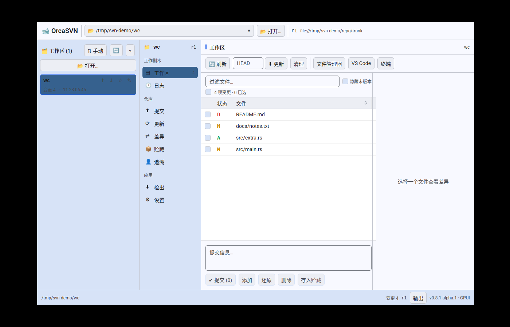
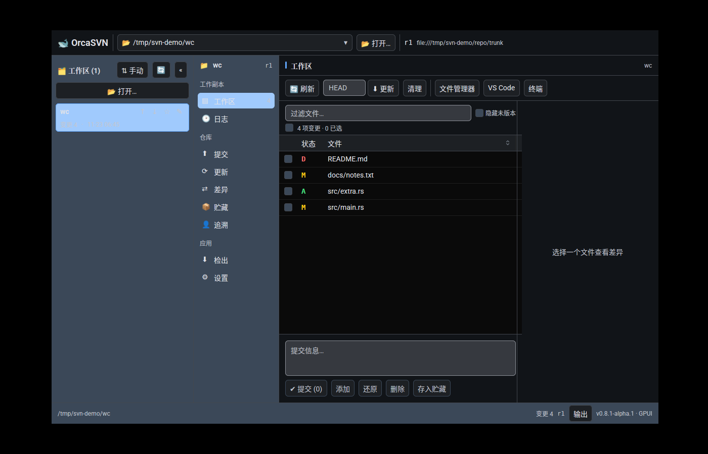

# 引入 gpui-kit-material 的可行性评估

维护日期：2026-11-23。评估对象为 [gpui-kit-material](https://github.com/mizorewww/gpui-kit-material) 0.2.0 与 `gpui` 分支的 `orcasvn-gpui`。

本轮只做可行性评估与迁移方案设计，没有修改源码、依赖清单或锁文件，也没有实际编译。文中的版本、特性、体积与行数来自 crates.io 元数据、crate 源码和本仓库现有代码；编译结论需由下文 Phase 0 验证。任何一条数据与实际不符时，以 Phase 0 的实测结果为准，并同步修订本文。

## 结论

技术上可行，但不能按默认配置直接引入。该库与本项目的底层栈完全同源（同样的 `gpui-kit 0.10`、`gpui-base 0.10.0` 和 `gpui-pre 0.3.12` 快照），并且它的主题层会主动把 Material 配色投影到 `gpui-kit` 已有的全局 `Theme` 上，因此现有页面和 Kit 控件不需要重写就能跟随新配色。

真正的阻碍不是架构，而是三点：

1. 默认特性会启用 `gpui-fast`，经 Cargo 特性统一后**替换整个应用的渲染引擎**，且不会在项目代码里留下任何 diff。
2. 它要求 `rust-version = "1.98"`，当前本地工具链是 1.97.1，`cargo build` 会直接拒绝。
3. 默认图标特性把约 51 MB 字体与 SVG 链进二进制。

建议：以 `default-features = false` 手工挑选组件组、精确锁定 `=0.2.0`，先做 Phase 0 验证再接后续阶段。若 Phase 0 不通过，继续使用 `gpui-kit` 自带主题即可，损失的是 M3 Expressive 动效与形状形变，不涉及结构性能力。

## 评估依据

| 对象 | 版本 / 取值 | 说明 |
| --- | --- | --- |
| `gpui-kit-material` | 0.2.0，2026-11-18 发布 | crates.io 累计下载 298 次；仓库有 1 个未关闭 issue |
| `gpui-kit` | 0.10.0 | 与 `orcasvn-gpui/Cargo.toml` 现有依赖一致 |
| `gpui-base` | 0.10.0 | 已作为间接依赖出现在 `orcasvn-gpui/Cargo.lock` |
| GPUI 快照 | `gpui-pre 0.3.12` | 现有锁文件中的同一版本 |
| 许可证 | `MIT AND Apache-2.0` | 形状与动效规则移植自 AndroidX，需随分发保留声明 |

`gpui-kit-material` 的仓库自带 `[patch.crates-io]`（`gpui-kit`、`gpui-fast`、`gpui-pre` 都指向 `vendor/`），但 patch 段不随 crate 发布，crates.io 上的 0.2.0 是对着官方 0.10.0 编译的。这正是本项目需要的结果，无需额外 patch。

## 现有代码规模

| 指标 | 数值 | 出处 |
| --- | --- | --- |
| 客户端行数 | 7,627 行 / 19 个文件 | `orcasvn-gpui/src` |
| 共享控件层 | 426 行 | `orcasvn-gpui/src/ui.rs` |
| `ui::button` / `ui::checkbox` 调用点 | 73 处 / 11 个文件 | `src/pages/*.rs`、`src/app.rs` |
| 直接构造颜色 `rgb(...)` | 109 处 | 全仓 |
| `pal.*` 取值 | 135 处 | 全仓 |
| Kit 对话框 / 右键菜单 | 3 处 `open_dialog`、1 处 `PopupMenu`（6 项） | 3 个文件 |
| `KitTheme` 引用 | 10 处 | `app.rs`、`main.rs`、`ui.rs` |

## 为什么可行：主题桥接

`gpui-kit-material` 不是一套平行主题，而是把 Material 方案投影进 `gpui-kit` 已有的 `gpui-component::Theme` 全局：

- `theme::init_component_theme(scheme, scale, cx)` 写入 Material 当前配色、正文字体族、基准字号和 rem 比例。
- `theme::advance_component_theme(target, scale, window, cx)` 推进过渡动画并同步投影，返回是否还有下一帧。
- 投影只接管正文字体、基准尺寸和配色，**不接管等宽字体，也不接管无关的几何值**。

因此：

1. `ui::palette_from_theme(KitTheme::global(cx))`（`src/ui.rs:110`）不用改签名，颜色会自动跟随 Material 方案，135 处 `pal.*` 先保持不动也能跑。
2. Kit 的 `DataTable`、`Input`、`Textarea`、`Resizable`、`PopupMenu` 和 `WindowExt` 对话框会自动获得 Material 配色。Material 没有数据表格组件，工作区列表继续用 Kit 的 `DataTable` 是设计内的结果，不是妥协。
3. `ui::mono_font()` 的等宽字体选择不受影响，差异视图和日志的代码字体保持现状。

多行输入同样有对应物：`TextField::multi_line(id, &Entity<TextareaState>)` 可直接包装现有的 `TextArea` 状态。

## 与现有设计规范的关系

`main` 分支的 Tauri 客户端已经在用 M3 语义变量（`src/design-tokens.css` 中的 `--md-sys-color-*`），主色为 `#1261a0`，深色下为 `#8bc7fa`。也就是说项目已有的设计语言就是 Material 3，`gpui` 分支的 `Palette` 反而是偏离的一方。引入本库是把两条分支拉回同一套语义，而不是换一种视觉风格。

`Palette` 到 Material 色彩角色的建议映射：

| `Palette` 字段 | Material 角色 | 备注 |
| --- | --- | --- |
| `window` | `SURFACE` | 应用画布 |
| `panel` | `SURFACE_CONTAINER_LOW` | 内容表面 |
| `elevated` | `SURFACE_CONTAINER_HIGH` | 悬浮/选中态表面 |
| `border` | `OUTLINE_VARIANT` | 分隔线与描边 |
| `text` | `ON_SURFACE` | 主要文字 |
| `muted` | `ON_SURFACE_VARIANT` | 次要文字 |
| `accent` | `PRIMARY` | 主操作 |
| `accent_soft` | `SECONDARY_CONTAINER` | 选中背景 |
| `add_bg` / `del_bg` | 无对应 | 差异底色，保留自定义值 |
| `ok` / `warn` / `err` / `conflict` | 无完整对应 | 可参考 `ERROR` 与 `design-tokens.css` 的 success/warning 语义色 |

品牌色用种子方案生成，而不是在内置主题上打补丁：`SeedScheme::new(0x1261a0).dark(is_dark).scheme()` 会从品牌色推导整套色彩角色（含 Kit 扩展的 `SUCCESS`、`WARNING`、`INFO`），表面与容器都带品牌色相。只覆盖 `PRIMARY` 会让背景仍停留在 Baseline 的紫色（Phase 0 实测）。

## 变更范围

| 区域 | 文件 | 规模 | 工作量 |
| --- | --- | --- | --- |
| 依赖与启动顺序 | `Cargo.toml`、`main.rs` | 约 30 行 | 小 |
| `ui.rs` 控件改为 Material 原语 | 1 个文件 | 4 个函数 | 中 |
| `Palette` 到色彩角色 | `ui.rs` | 15 个字段 | 小到中 |
| `ui::button` / `ui::checkbox` 调用点 | 11 个文件 | 73 处 | 中，机械改写 |
| 直接颜色构造 | 全仓 | 109 处 | 中 |
| `pal.*` 取值 | 全仓 | 135 处 | 中 |
| Kit 对话框 / 右键菜单迁移 | 3 个文件 | 3 处对话框、1 处菜单 | 中 |
| 外壳导航（rail / app bar / tabs） | `app.rs`、`sidebar.rs` | 2 个文件 | 中到大 |
| 主题切换与界面缩放 | `app.rs:274` | `apply_window` 需重构 | 中 |

合计约 1,200 至 1,800 行受影响，绝大部分是颜色与控件名的机械替换。真正的新工作是外壳导航和主题过渡的调度。

## 风险

按影响从高到低排列。

**1. 默认特性会替换渲染引擎。** 默认特性包含 `gpui-fast`，它会打开 `gpui-kit/gpui-fast` 并传递到 `gpui-base/gpui-fast`；`gpui-base` 随后以 `extern crate gpui_fast as gpui;` 使用快速后端。Cargo 的特性是并集语义，所以只要项目里任何一处启用了该特性，整张依赖图的引擎实现都被替换，而项目源码里看不到任何改动，还会额外引入 `gpui-fast`、`gpui-fast-platform`、`gpui-fast-web` 编译。处置：必须 `default-features = false`。

**2. MSRV 1.98 与本地 1.97.1 不兼容。** crate 声明 `rust-version = "1.98"`，本机 `rustc 1.97.1`，cargo 会直接报错退出。CI 使用的 stable 版本高于 1.98 时不受影响，但所有开发机的工具链都要升级并写入 `rust-toolchain.toml`。处置：先确认 CI 与各平台构建机的 rustc 版本，再决定是否引入。

**3. 图标资源约 51 MB。** `embedded-symbols` 也是默认特性，展开后是 Outlined 10.7 MB、Rounded 15.2 MB、Sharp 8.9 MB、补充 SVG 16.1 MB，全部链接进二进制。对一个 SVN 客户端来说代价过高。处置：不启用该特性；确需 Material 图标时，单独依赖 `gpui-material-symbols` 且只开 `outlined`。

**4. 0.2.0 是 5 天前的预发布。** API 明确不保证稳定，代码库仍标注 pre-release，下载量很低。处置：版本固定为 `=0.2.0` 或 vendor 进仓库；升级时按 breaking change 处理。

**5. 主题过渡不能写在 `render` 里。** `advance_component_theme` 的文档明确要求从主题/缩放事件和下一帧回调调用，不能在 `Render` 中调用。当前 `apply_window`（`src/app.rs:274`）在 `render` 内调用 `KitTheme::change`，并直接用 `window.set_rem_size` 处理界面缩放。迁移后需要改为计划回调，并把 `zoom` 作为 `scale` 参数交给 Material，而不是自己设 rem。

**6. 状态色只有部分对应。** `SeedScheme` 会生成 Kit 扩展的 `SUCCESS`、`WARNING`、`INFO`，`ok`、`warn`、`err` 可以映射过去；`add_bg`、`del_bg`、`conflict` 仍没有 M3 角色，差异底色需保留自定义值，与纯 Material 表面会有轻微色温差异，需要视觉确认。

**7. 现有 `Palette` 映射会降低深色模式对比度。** `palette_from_theme` 把 `accent` 取 `colors.blue`、`accent_soft` 取 `colors.selection`。Material 投影后 `selection` 是主色的半透明叠加，深色模式下选中卡片仍为浅蓝，而 `muted`（`ON_SURFACE_VARIANT`）也是浅色，文字对比度明显下降（Phase 0 截图可见）。这就是 Phase 2 必须改用 `ColorRole`、不能再沿用 Kit 旧字段的直接原因。

**8. 许可证需随分发保留声明。** 上游是 `MIT AND Apache-2.0`，移植文件来自 AndroidX。与项目 MIT 兼容，但发布包需包含相应 NOTICE 与许可证文本。

## 集成方案

### 依赖

```toml
gpui-kit-material = { version = "=0.2.0", default-features = false, features = [
    "buttons", "selection", "inputs", "menus", "dialogs",
    "navigation", "feedback", "progress", "shapes", "dynamic-color",
] }
```

刻意不启用：`embedded-symbols`（图标体积）、`gpui-fast`（引擎替换）、`pickers`（暂时不需要日期/时间选择）、`adaptive`。`dynamic-color` 需要打开：内置主题的 Baseline 是紫色系，直接用会让整个界面偏紫；用品牌种子色生成方案才与 Tauri 客户端一致。需要日期选择时再单独打开 `pickers`，它会带 `chrono`。

### 启动顺序

```rust
gpui_kit::init(cx);                        // 注册 Kit 的主题、Root、输入与对话框
ui::init_fonts(cx);                        // 等宽字体选择保持现状

let settings = crate::settings::Settings::load();
let mode = /* 设置 + 系统外观 */;
KitTheme::change(mode, None, cx);          // 先加载 Kit 的模式配置

let scheme = SeedScheme::new(0x1261a0)     // OrcaSVN 品牌色
    .dark(mode.is_dark())
    .scheme();
theme::init_component_theme(scheme, settings.zoom, cx);  // 必须在 open_window 之前
```

`init_component_theme` 必须在 `open_window` 之前完成，因为它要在 Root 首次渲染前写好 Kit 主题；输入控件在构造时就会捕获样式。`KitTheme::change` 要排在它前面：Component 在模式变化后会重新加载模式配置，先加载再投影才不会被覆盖。

`gpui_kit_material::init(cx)` 暂时不要调用。它会把 Kit 的内置图标（下拉箭头 `unfold_more`、空状态 `inbox`）重定向到 Material Symbols 路径；未启用 `embedded-symbols` 时这些资源不存在，图标变空白并持续报错（Phase 0 实测）。等图标方案确定后再打开。

### 主题切换与缩放

`apply_window` 中的两件事分开处理：主题/缩放变化时记录目标并在下一帧回调里调用 `advance_component_theme`，不再在 `render` 内直接改 `KitTheme` 和 rem。过渡是否继续由返回值决定，同一时刻只保留一个待执行回调。

动效方案可用 `gpui_kit_material::motion::set_motion_scheme(MotionScheme::Standard)` 降级，减少与现有交互节奏的差异。

### 分阶段

| 阶段 | 目标 | 验收 |
| --- | --- | --- |
| Phase 0 | 只改依赖与启动顺序，页面代码不动 | ✅ 2026-11-23 通过，见下节 |
| Phase 1 | 重写 `ui.rs` 的 `button`、`checkbox`、`spinner`、`status_badge` | 73 处调用点签名不变即可通过编译 |
| Phase 2 | `Palette` 改为 `ColorRole` 查询的薄封装，保留差异/状态自定义色 | `pal.*` 与 `rgb(...)` 通过类型改动收敛，不逐个改 240 余处 |
| Phase 3 | 外壳：`NavigationRail`、`TopAppBar`、`MaterialTabs` 替换手写导航 | 快捷键、焦点、分栏与折叠行为不变 |
| Phase 4 | 3 处 `open_dialog` 与 1 处右键菜单改用 `MaterialDialog`、`MaterialContextMenu` | 现有确认/右键流程行为一致 |

Phase 0 是唯一的决策点：通过则后续是低风险的外观重构，不通过就没有必要继续。

## Phase 0 实测结果

2026-11-23 在 `gpui-material-phase0` 分支完成，只改 `Cargo.toml`、`Cargo.lock` 和 `main.rs`，页面代码未动。

环境：rustc 1.98.0、Xvfb + lavapipe（软件 Vulkan）、演示工作副本含 2 个修改 / 1 个新增 / 1 个删除。

| 检查项 | 结果 |
| --- | --- |
| `cargo check --all-targets` | 通过，无警告，3 分 09 秒 |
| `cargo build` | 通过，7 分 08 秒（首次），1 分 20 秒（增量） |
| 锁文件新增 | `gpui-kit-material`、`gpui-kit-material-color`、`gpui-material-symbols`，共 3 个 |
| `gpui-fast` | 未出现在锁文件，`gpui-pre 0.3.12` 仍是唯一引擎 |
| 无头启动 | 正常进入工作区，无 panic |





结论：主题桥接成立，`palette_from_theme` 与 Kit 的 `DataTable`、`Input`、对话框都跟随了新配色，无需改页面代码。同时暴露四个必须处理的问题：

1. **Baseline 是紫色系。** 不生成种子方案时整个界面泛紫，只覆盖 `PRIMARY` 不够，`dynamic-color` 不是可选项。
2. **`gpui_kit_material::init` 会打断 Kit 内置图标。** 无 `embedded-symbols` 时下拉箭头与空状态图标空白，并持续输出 `could not find asset at path "material-symbols/rounded/..."`。Phase 0 先不调用。
3. **正文依赖 Roboto。** 桥接把 sans 设为 Roboto，系统没有时回退到其他字体。实测把上游 gallery 的 Regular / Medium / SemiBold 放进字体目录后正常；产品化需要随包附带（Apache-2.0）并保留许可。
4. **旧字段映射在深色下对比度不足。** `accent`/`accent_soft` 取 Kit 的 `colors.blue`/`colors.selection`，Material 投影后选中卡片出现浅底浅字，印证 Phase 2 必须改用 `ColorRole`。

另外确认两点利好：`SeedScheme` 自带 `SUCCESS`、`WARNING`、`INFO`，状态色不必全靠自定义；主题投影不影响等宽字体与几何值。

## 待定事项

- **主题与品牌色**：已确定为 `SeedScheme` 从 `#1261a0` 生成，而非内置主题加覆盖。深浅两套由此自动推导，无需另存。
- **图标策略**：不引入 Material 图标、只引入 `rounded`（15.2 MB）、或沿用现有文字/符号。在决定前 `gpui_kit_material::init` 不能调用。建议先不引入，避免额外体积。
- **`Palette` 是否保留**：作为 `ColorRole` 的兼容层保留一个版本，还是直接改用 `color(ColorRole::…)`。建议保留一层，降低一次性改动面。
- **外壳是否迁移**：Phase 3 的收益主要是 Expressive 动效与统一导航外观，工作量最大。可以先只做 Phase 1、2、4。
- **版本策略**：锁定 `=0.2.0` 还是 vendor。若上游迭代频繁，vendor 更稳。

## 参考

- [gpui-kit-material 仓库](https://github.com/mizorewww/gpui-kit-material)
- [在线 Gallery](https://material.mizore.blog/gallery/)
- [crates.io: gpui-kit-material](https://crates.io/crates/gpui-kit-material)
- [Longbridge GPUI Kit](https://github.com/longbridge/gpui-kit)
- 项目内对照：[视觉规范](visual-design-system.md)、[设计变量](../src/design-tokens.css)
